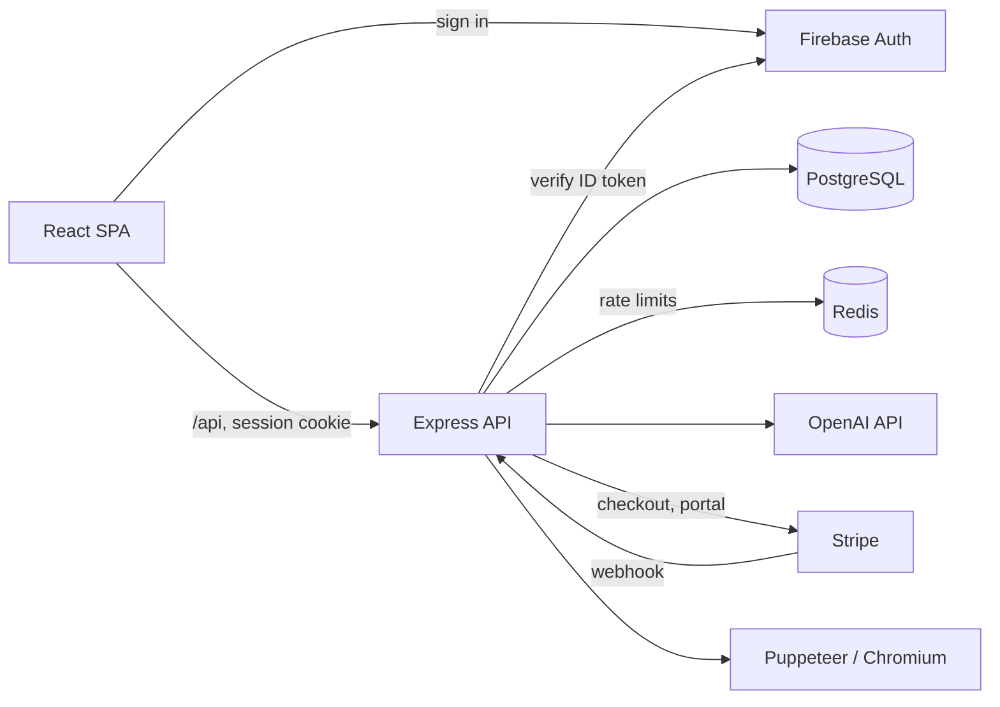

# Codebase structure

ResumeCraft is two independent npm packages in one repository: a React single-page app (`frontend/`) and an Express API (`backend/`). There is no root `package.json` or shared package.

- [Backend](backend.md): API entry points, modules, layers and request flows
- [Frontend](frontend.md): routing, auth and pages
- [Data model](data-model.md): PostgreSQL tables and what uses them
- [Operations](operations.md): configuration, tests and deployment

For local setup, see the [project README](../README.md).

## Repository layout

```text
.
├── backend/                 Express 5 API (CommonJS)
│   ├── server.js            Process entry point
│   ├── app.js               Express app: middleware and module mounting
│   ├── firebaseAdmin.js     Firebase Admin initialisation
│   ├── modules/             Domain modules (see backend.md)
│   ├── routes/              Route definitions
│   ├── controllers/         HTTP handlers, including careerTools/
│   ├── services/            Cross-domain services and the OpenAI client
│   ├── middleware/          Auth, plan gating, rate limits, errors
│   ├── config/              PostgreSQL, Redis, Stripe, OpenAI clients
│   ├── shared/http/         Zod validation helper
│   ├── observability/       Pino, Prometheus, Sentry
│   ├── templates/           HTML/CSS document templates and PDF renderer
│   ├── db/schema.sql        Database schema and seed plans
│   ├── tests/               node:test (*.test.js) and Jest (*.jest.js)
│   └── Dockerfile
├── frontend/                React 19 + Vite 7 SPA
│   ├── src/                 Application code (see frontend.md)
│   ├── tests/               Vitest tests
│   └── e2e/                 Playwright tests
├── docs/                    This documentation
├── .firebaserc              Firebase project selection
└── firebase.json            Hosting config (gitignored, local only)
```

## System overview


