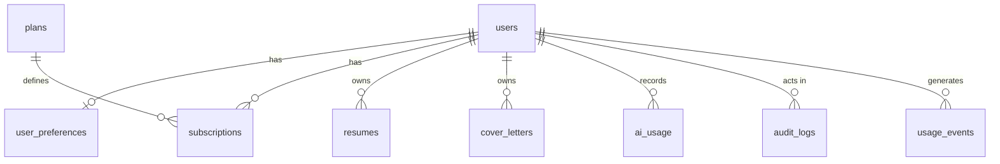

# Data model

The PostgreSQL schema is `backend/db/schema.sql`. It also installs `pgcrypto` and `citext` and seeds plans. There is no ORM; code uses `pg` through `backend/config/db.js`. No migrations are tracked.

| Area | Tables |
| --- | --- |
| Identity | `users`, `auth_identities`, `user_preferences` |
| Billing | `plans`, `subscriptions`, `payment_transactions`, `stripe_webhook_events` |
| AI usage | `ai_usage`, `ai_generations` |
| Resumes | `resumes`, `resume_skills`, `work_experiences`, `educations`, `education_subjects`, `projects`, `project_technologies` |
| Cover letters | `cover_letters` |
| Platform | `feature_flags`, `audit_logs`, `usage_events` |

## Core relationships

- A trigger gives each new user an active Free subscription.
- A partial unique index allows only one `active` subscription per user.
- Generated resume content is stored as JSON text in `resumes.generated_text`.

## Tables without active code paths

The module repositories do not query `auth_identities`, `payment_transactions`, `ai_generations` or the resume child tables. The only code found for `projects` is the unused `projectController.js`.
